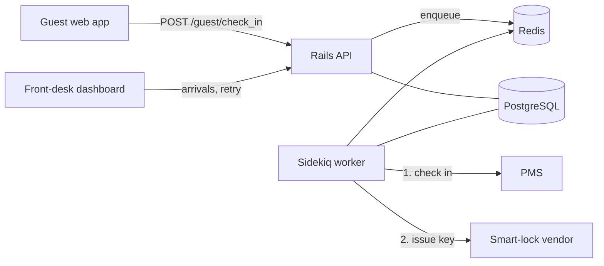

# QuickCheck

Contactless hotel check-in. A guest looks up their booking, completes the legally required registration, and receives a smart-lock door code. Behind the scenes the check-in is pushed to the hotel's Property Management System (PMS) and a digital key is requested from the lock vendor — both unreliable third parties. Front-desk staff get a live dashboard of today's arrivals and can retry anything that failed.

| Layer | Stack |
| --- | --- |
| API | Ruby on Rails 8 (API mode), PostgreSQL, Sidekiq + Redis, Faraday |
| Web | Vue 3 (Composition API, `<script setup>`), TypeScript, Vite, Tailwind CSS v4, shadcn-vue |
| Third parties | Mock PMS + smart-lock service (Node, zero dependencies) with failure injection |
| Quality | RSpec + WebMock, Vitest + Vue Test Utils, RuboCop (rails-omakase), GitHub Actions |

## Running it

```bash
docker compose up --build
```

| URL | What |
| --- | --- |
| http://localhost:5173 | Guest check-in |
| http://localhost:5173/staff | Front-desk dashboard (token `demo-staff-token`) |
| http://localhost:3000/sidekiq | Sidekiq UI (`staff` / `demo-staff-token`) |

Seeded bookings all arrive today: `QC1001 Tanaka` (JP), `QC1002 Smith` (GB), `QC1003 Santos` (PH), `QC1004 Kim` (KR), and `QC1005 Brown`, which is cancelled in the PMS and always fails.

Reset the demo data with `docker compose exec api bin/rails demo:reset`.

## Demo script

1. **Happy path.** Check in as `QC1002 / Smith`. The mock fails ~30% of calls, so you will often see a step retry before the door code appears.
2. **Outage and recovery.** Take the third parties down, check in `QC1003 / Santos`, and watch the job back off in the Sidekiq UI until the check-in lands in *Needs attention* (~2 minutes):
   ```bash
   curl -X POST localhost:4000/__control -d '{"outage": true}'
   ```
   Bring them back with `-d '{"outage": false}'` and press **Retry** on the dashboard.
3. **Permanent failure.** Check in `QC1005 / Brown`. The PMS answers `409`, so the check-in fails immediately instead of retrying for minutes.

## Architecture



A check-in is a small state machine, advanced by two Sidekiq jobs:

```
pending ──SyncToPmsJob──▶ pms_synced ──IssueDigitalKeyJob──▶ key_issued
   └──────────────▶ failed ◀──────────────┘
```

## Design decisions

- **Transient vs permanent errors.** Timeouts, connection errors, 5xx and 429 raise `Integrations::TransientError` and Sidekiq retries with short exponential backoff (a guest is standing at the door). Other 4xx raise `PermanentError` and fail fast, because retrying a cancelled booking only delays the front desk.
- **Idempotency keys.** Each step sends a key derived from the check-in's UUID. The mock deliberately produces *ghost successes* (work done, `504` returned); the retry replays the same key and the vendor returns the original key instead of issuing a second one.
- **Safe to run twice.** A unique index guarantees one check-in per reservation, so a double-tapped submit returns the existing check-in. Jobs check the current status under a row lock before advancing, so duplicate or late jobs are no-ops.
- **Retry resumes where it stopped.** A failed check-in that already reached the PMS goes straight back to key issuance.
- **Guest auth without accounts.** Booking code + last name returns a 2-hour `signed_id` token scoped to one reservation. Lookups are rate limited, and the API gives the same answer for a wrong code and a wrong name.
- **Personal data.** Passport numbers (required for foreign guests under Japan's Hotel Business Act) are encrypted at rest with Active Record Encryption, filtered from logs, and only ever returned masked. Internal integration errors are visible to staff only.
- **Audit trail.** Every outbound call is stored as an `IntegrationEvent` (provider, outcome, HTTP status, latency): the first place to look when a guest says their key never arrived.

## Tests

```bash
docker compose exec -e RAILS_ENV=test api bin/rails db:prepare
docker compose exec -e RAILS_ENV=test api bundle exec rspec
docker compose exec api bundle exec rubocop
docker compose exec web npm test
docker compose exec web npm run build   # includes vue-tsc type-check
```

## With more time

- Receive PMS webhooks (room moves, cancellations) on a TypeScript AWS Lambda managed by Terraform, verified by HMAC signature.
- Replace the shared staff token with SSO and roles.
- Push status to the guest over Action Cable or SSE instead of polling.
- Japanese localisation, Sentry, and a retention policy that purges passport data after the legal period.
- Production config: Redis-backed cache store (rate limiting), encryption keys from credentials, and a production Dockerfile.
